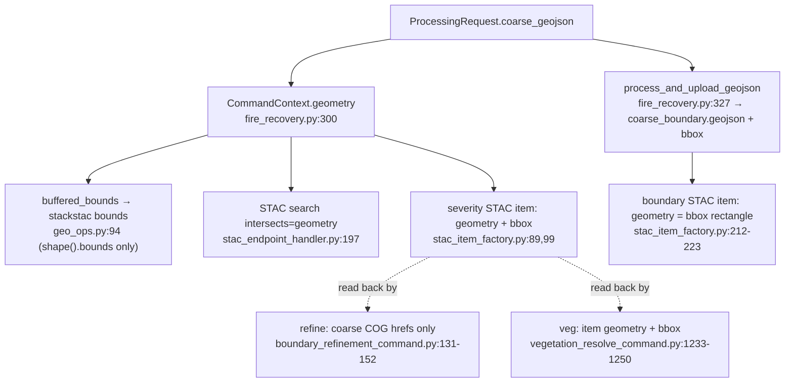

# boundary-geometry-outputs — backend

## What this covers

What happens downstream of `ProcessingRequest` once `coarse_geojson` is normalized. After
normalization it is always a `MultiPolygon`, Z is dropped, rings are oriented per RFC 7946,
and coordinates are snapped to micro-degrees (about 0.11 m). The frontend confirmed its side
is unaffected. This document is the backend's output-side check.

## What it does not cover

The hash itself; the `/upload/geojson` preview path, except question 5.

## How it works

`request.coarse_geojson` is passed as-is into the background task
(`fire_recovery.py:265`), then into `CommandContext.geometry` (`:300`). It has five
consumers, and **the coarse analysis never clips a raster to the geometry**. Only its bbox
and the STAC search use it.

Order of writes on success:

1. COGs are written.
2. The severity STAC item is written, inside the command.
3. `job_result.json` is written (`fire_recovery.py:318`).
4. `coarse_boundary.geojson` is uploaded.
5. The boundary STAC item is written.

The calculators under `src/computation` never read the geometry. `src/process/spectral_indices.py`
is not imported anywhere in `src/`; only tests import it.

## Entry points

- `process_fire_severity` (`fire_recovery.py:281`)
- `FireSeverityAnalysisCommand.execute` (`fire_severity_command.py:117-185`)
- `process_and_upload_geojson` (`boundary_utils.py:24`)
- `STACItemFactory.create_fire_severity_item` / `create_boundary_item`

## Cross-repo edges

None new. The `coarse_boundary.geojson` URL and the STAC item geometry reach the frontend
through the result responses defined in the published OpenAPI schema.

## Answers

Answers 1 and 3 were checked by running the code on four inputs: a `Polygon`, a one-polygon
`MultiPolygon` of the same ring, the same `MultiPolygon` with the ring reversed, and a
`Feature` wrapping the `Polygon`. The scripts ran against `ab7fa19`. The existing geometry
tests (`test_multipolygon_*`, `test_stac_item_factory`, refine, upload: 98 tests) pass.

1. **`boundary_utils.py` and `stac_item_factory.py` with a `MultiPolygon`: correct.**
   - `coarse_boundary.geojson` is a `FeatureCollection` of one `Feature` whose geometry is
     stored as `MultiPolygon`, with `properties: {"created": <now>}`.
   - The bbox is identical for all four inputs.
   - Micro-degree coordinates survive the shapely round trip unchanged: 2000 random
     `MultiPolygon`s gave 0 mismatches.
   - The severity item gets `geometry.type = MultiPolygon` and the same bbox, and passes
     STAC schema validation.
   - The boundary item's geometry is a bbox rectangle whatever the input shape, so it is
     unaffected.

   **Today, a `Feature` input fails.** It passes the model, but:
   - `create_fire_severity_item` puts `Feature.__geo_interface__` into the item's
     `geometry`, which fails `pystac` validation ("is not valid under any of the given
     schemas").
   - Earlier than that, `intersects=<Feature>` is rejected by both sentinel-2 providers.
     Element 84 returns "Expected GeoJSON geometry, not Feature"; Planetary Computer returns
     a 422.

   So a `Feature` analyze request cannot succeed at `ab7fa19`, and normalization makes it
   work. Its `properties` would have been kept in `coarse_boundary.geojson`. After
   normalization they are dropped, and no stored output depends on them.
2. **Refine and veg reading the coarse boundary back.** Neither reads
   `coarse_boundary.geojson`.
   - **Refine** reads only the severity item's asset hrefs (`boundary_refinement_command.py:131-152`).
     It clips with its own `refined_geojson`, which this plan does not normalize.
   - **Veg** reads the severity item's `geometry` and `bbox` for its own STAC item. It
     dispatches on `type` and accepts `MultiPolygon` (`vegetation_resolve_command.py:1239-1250`).
     For its mask, veg reads whatever `geojson_url` the client sends, through `gpd.read_file`,
     which handles any shape.
   - The only `Polygon` assumption is `_create_fallback_metadata`
     (`vegetation_resolve_command.py:1321-1329`), which reads `coordinates[0]` as a ring. It
     is unreachable: veg always builds its context with `geometry=None`
     (`fire_recovery.py:876`).
3. **Clipping and masking: no difference.**
   - `crop_cog_with_geometry` (`cog_ops.py:74-104`, `rio.clip(all_touched=True)`) was run on
     a synthetic 200×140 raster with all four inputs plus a Z-coordinate `Polygon`. It gave
     byte-identical output of the same shape each time. Rasterization ignores both ring
     orientation and single-vs-multi.
   - On the coarse path there is no clip at all. `buffered_bounds` uses only `.bounds`, and
     those are identical.
   - The live STAC search returned **the same item set** for `Polygon`, `MultiPolygon` and
     the reversed ring: 4 items on Element 84 and 8 on Planetary Computer, for 2023-06-01/22
     over the example AOI.

   Quantization can move the bounds by up to 0.5 µdeg, which can shift the stackstac grid.
   That is the intended effect of feeding the quantized geometry to the pipeline.
   `geo_ops.py`, `polygon_ops.py` and `spectral_indices.py` have nothing orientation- or
   type-sensitive on the live path.
4. **Is the raw request geometry read anywhere?** No. There is no `Request` parameter and no
   `.body()` or `.json()` read anywhere in `src/`. Every route takes a pydantic model, Form
   fields or path params. The validated model does differ from the raw body, though:
   - numeric strings in coordinates are coerced to floats;
   - unknown keys are dropped;
   - `sensor` gets its default;
   - `model_dump()` adds `"bbox": None` to the geometry.

   So any hashing code that reads the raw dict would see a different request from the one
   the pipeline sees (see below).
5. **Is the `/upload/geojson` copy ever read as the boundary?** Not by the backend on its
   own. The upload mints a fresh `uuid4` job_id (`fire_recovery.py:642`) and writes:
   - `assets/{uuid}/boundaries/…`;
   - `{name}/{uuid}/…`;
   - a boundary STAC item `{name}-boundary-{uuid}` (`upload_aoi_command.py:320-400`).

   Every reader looks up by the *analyze* job_id:
   - the result endpoints;
   - refine's `{name}-severity-{job}`;
   - veg's severity patterns.

   The fire-event-wide listers (`STACJSONManager.get_items_by_fire_event`/`search_items`)
   have no callers on a route. The one exception is veg's `geojson_url`: it is client-chosen,
   so a client that passes the upload URL gets the preview copy as its veg mask, and the
   backend doesn't check it against the job. Separately, `/upload/geojson` accepts only a
   `Feature` in practice. A bare `Polygon` or `MultiPolygon` passes the model, then returns
   500 "Unsupported GeoJSON type" (`upload_aoi_command.py:166-174`).

## Contradicts the plan

- **`job_id_from_request_body(body: dict, …)` versus "the id is a pure function of the
  validated request".** `be-canonicalizer` gives the function a raw body and says it
  normalizes, and `be-vectors` feeds it raw bodies. Normalization lives in
  `ProcessingRequest`'s validator (`be-request-normalization`), and the model is not the
  identity on the raw body (answer 4). If the function works on the dict directly, the hash
  and the pipeline can disagree. That is the bypass question 4 asks about. The function
  needs to run `ProcessingRequest.model_validate(body)` and hash the result, or the router
  needs to hash the model rather than the body.
