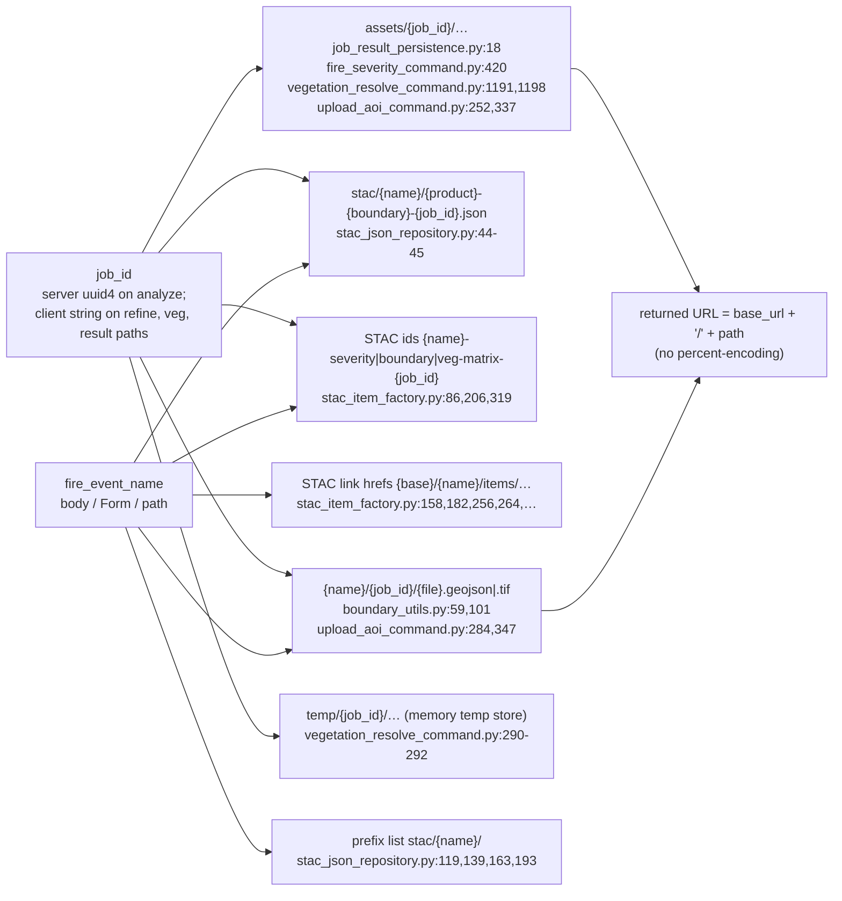

# client-strings-in-storage-paths — backend

## What this covers

Every place a client-supplied string (`fire_event_name`, a client-sent `job_id`) becomes part of
a storage path, object name, STAC id or URL, and what each of those places tolerates. This sets
the bounds for the `fire_event_name` pattern in `be-name-validation`.

## What it does not cover

Choosing the pattern (that's `be-name-validation`); geometry handling. The veg request's
three client URLs (`veg_gpkg_url`, `fire_cog_url`, `geojson_url`) are fetched server-side
(`vegetation_resolve_command.py:276-322`). They are never path segments, so they are out of
scope here.

## How it works

Nothing escapes or encodes these strings. They are interpolated with f-strings and passed
to obstore (`MinioCloudStorage`, an `S3Store`). URLs are built as `f"{base_url}/{path}"`
(`minio.py:146`).

What obstore does with a segment (checked with `MemoryStore` and `LocalStore`; path
parsing is obstore's, shared by `S3Store`):

| `fire_event_name` | Result |
| --- | --- |
| `..`, `.`, `../x` | `ValueError: Could not parse path`. The write fails, so there is no traversal. |
| `""`, `a//b`, trailing `/` | `ValueError` (empty path segment) |
| `a/b` | Accepted. Creates an extra level: `stac/a/b/…`, `a/b/{job}/…`. |
| `a b`, `%`, `#`, `?`, `\`, non-ASCII | Accepted as object names. The returned URL is not encoded. |
| 1100 chars | Accepted by the store. GCS caps a whole object name at 1024 UTF-8 bytes. |

## Entry points

`fire_event_name` enters in eight places:

- Body models: `ProcessingRequest` (`requests.py:37`), `RefineRequest` (`:80`),
  `VegMapResolveRequest` (`:107`), `GeoJSONUploadRequest` (`:150`).
- Form field: `POST /upload/shapefile` takes `fire_event_name: str = Form(...)`
  (`fire_recovery.py:698`). This is not a model.
- Path params: `GET /result/analyze_fire_severity/{fire_event_name}/{job_id}` (`:365`),
  `/result/refine/…` (`:526`), `/result/resolve_against_veg_map/…` (`:943`).

Client `job_id` enters at `RefineRequest.job_id` (`requests.py:85`),
`VegMapResolveRequest.job_id` (`:114`), and the `{job_id}` path param of the three result
endpoints. None of these is validated.

## Cross-repo edges

- component:default/fire-recovery-frontend compiles the published pattern with JS `RegExp`
- component:default/fire-recovery-validation sanitizes CalFire `FIRE_NAME` values to it

## Answers

1. **Where `fire_event_name` becomes a segment, and what breaks it:**
   - **Object names** `{name}/{job_id}/…` (`boundary_utils.py:59,101`,
     `upload_aoi_command.py:284,347`) and **STAC JSON paths** `stac/{name}/…`
     (`stac_json_repository.py:45`). Names written to these paths today:
     - The coarse boundary on the **analyze** path, via `fire_recovery.py:327`.
     - Refined boundaries and COGs.
     - Upload copies.
     - Every STAC item.

     What breaks them:
     - `..`, `.`, empty, or `//`: rejected by obstore, so the background task fails.
     - `/`: silently nests. `_extract_search_terms_from_path` (`stac_json_repository.py:50-52`)
       then misparses `parts[1]`. Listing `stac/a/` also returns everything under `stac/a/b/`.
       Lookups still match on the full `id`, so this costs extra reads, not wrong results.
   - **STAC ids** `{name}-severity-{job_id}` and similar. The id ends in a fixed-length uuid,
     so no two (name, job) pairs collide, even with `-` in names.
   - **URLs.** `get_url` (`minio.py:146`) and the STAC link hrefs (`stac_item_factory.py`)
     put the raw name into URLs the frontend loads, and that the veg endpoint fetches when a
     client echoes them back.
     - `#` truncates the URL, and `?` turns the rest into a query string.
     - A space makes an invalid URL.
     - `%` makes it ambiguous: the name `a%20b` yields a URL that GCS decodes to object
       `a b`, so it resolves to a different object.
     - Non-ASCII depends on the consumer's encoding.
   - **Result endpoints.** A path param cannot contain `/`: Starlette's `str` convertor
     stops at `/`, and `%2F` is decoded before routing, which gives a 404. A body-submitted
     name containing `/` produces a job whose result URL can never be polled.
   - **Case.** GCS is case-sensitive, so `Fire` and `fire` are distinct events. There is no
     folding anywhere, and so no collision.
   - **Length.** The longest fixed suffix around the name is about 70 bytes
     (`stac/{name}/fire_severity-refined-{uuid}.json`), so any `max_length` well under 900
     UTF-8 bytes stays within GCS's 1024-byte limit.

   The safe set, from the code's point of view, is `[A-Za-z0-9_-]`. The pattern must exclude
   `/`, `.`-only names, the empty string, `%`, `#`, `?`, whitespace and `\`.
2. **Entry points.** The four body models are **not** every entry point: add the
   `upload_shapefile` Form field and the three result path params (see Entry points). All
   of them can take the constraint. With FastAPI 0.115.12 / pydantic 2.11.3, a single
   `FireEventName = Annotated[str, Field(pattern=..., max_length=...)]` used as:
   - a model field,
   - a bare path-param annotation,
   - `Annotated[FireEventName, Path()]`, and
   - `Annotated[FireEventName, Form()]`

   is enforced in all four positions (422 on `"a b"`) and emitted as `pattern`/`maxLength`
   in OpenAPI for each. The path params should carry it too: then the schema tells clients
   the same rule on read as on write, and a bad name gets a 422 instead of a silent
   `pending`.
3. **Client `job_id`.** Yes, it is used as a path segment without validation. Obstore
   blocks traversal (`..`, `.`, empty segments). What remains:
   - **Refine** writes before it checks that the job exists. It uploads
     `{name}/{job_id}/refined_boundary.geojson` (`boundary_refinement_command.py:120`)
     *before* looking up the STAC item (`:131-142`). It then always persists
     `assets/{job_id}/job_result.json` (`fire_recovery.py:500,522`), even for a job_id that
     never existed.
   - **Veg** always persists `assets/{job_id}/job_result.json` (`fire_recovery.py:900,939`).
     On success it also writes `assets/{job_id}/vegetation/…`.
   - Either command, given another analyze job's id, overwrites that job's
     `job_result.json`. This is the live bug `be-result-path` fixes. `/` in a `job_id` nests
     paths.
   - **Result endpoints** only read. A bad `job_id` reads as `pending`.

   A UUID-shaped constraint on `RefineRequest.job_id`, `VegMapResolveRequest.job_id` and
   the three `{job_id}` path params costs nothing: both the current uuid4 ids and the
   planned uuid5 ids match `^[0-9a-f]{8}-[0-9a-f]{4}-[0-9a-f]{4}-[0-9a-f]{4}-[0-9a-f]{12}$`.
   It closes the arbitrary-key writes. It does not stop overwriting another *real* job;
   only namespacing does that.
4. **Code assuming rejected characters.**
   - Nothing in `src/` needs anything outside `[A-Za-z0-9_-]`. The internal health-check
     name `"health-check"` (`fire_recovery.py:186,220`) goes through `CommandContext`, not
     a request model, and contains `-`.
   - Tests use `"test-fire"`, `"test_fire_2024"`, `"Geology_Fire"`,
     `f"test_fire_{uuid4}"` and similar. A pattern without `-` would force test edits.
   - Two command tests set `fire_event_name = ""` on a `CommandContext` to exercise context
     validation (`test_boundary_refinement_command.py:175`,
     `test_vegetation_resolve_command.py:203`). They don't go through the models, so they
     are unaffected.

## Contradicts the plan

- **Intent (c), "no client-supplied string becomes a storage path segment on the analyze
  path", is not what the plan delivers.** `fire_event_name` is a segment on the analyze path:
  the coarse boundary at `{fire_event_name}/{job_id}/coarse_boundary.geojson`
  (`boundary_utils.py:59`, via `fire_recovery.py:327`), and every STAC item at
  `stac/{fire_event_name}/…` (`stac_json_repository.py:45`). No work item removes it.
  `be-name-validation` validates it but leaves it in the path. What holds is "no
  *unvalidated* client string", which is the wording in `000_HASH_JOB_ID.md` item 4.
- **"Used by all four request models" is not every entry point.** `be-name-validation`'s
  done-when checks four models. The `upload_shapefile` Form field (`fire_recovery.py:698`)
  and the three result-endpoint path params also carry `fire_event_name`. As written, they
  would stay unconstrained, and the Form field writes object names
  (`upload_aoi_command.py:284,347`).
