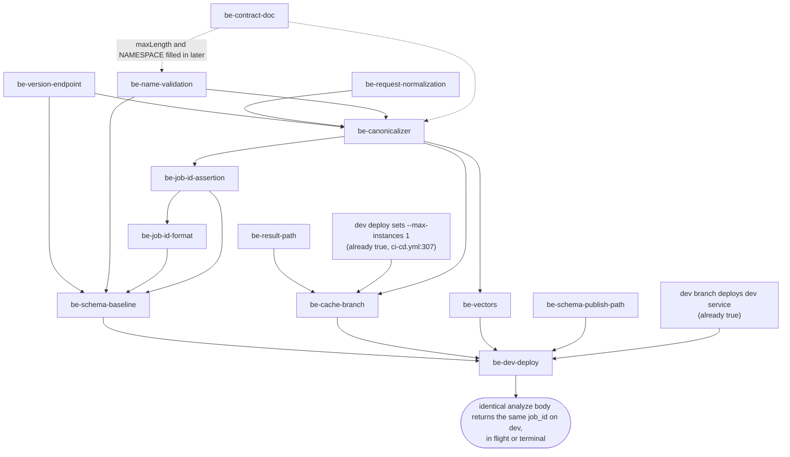

# Deterministic `job_id` — backend

## What this repo does

Replaces the `uuid4` `job_id` for `analyze_fire_severity` with a `uuid5` derived from the
validated, normalized request, so any client recovers from a lost response by resubmitting the
identical body and getting the same id back. It first fixes the shared `job_result.json` path, a
live bug that doesn't depend on the id scheme, and the CI step that publishes the OpenAPI schema
under the wrong object name. It also becomes the **single home of the cross-repo decision log and
the `job_id` contract**, in a tracked `docs/JOB_ID.md` that the frontend and validation repos link
to rather than copy. This is the only repo that computes a `job_id`.

## Why, in one paragraph

`job_id` is minted at `src/routers/fire_recovery.py:257` and exists only in the response body.
When Cloud Run returns a 504, Starlette still runs the BackgroundTask, so the work happens but
the handle is lost. Deriving the id from the request means the server can recognize a
resubmission. The intent is met when:

- (a) resubmitting an identical body after a 504 returns the same id without starting a second
  computation;
- (b) two bodies the pipeline would treat differently never share an id (when unsure,
  over-distinguish: duplicate work is cheaper than serving one request another's results);
- (c) no **unvalidated** client-supplied string becomes a storage path segment. `fire_event_name`
  remains a segment on the analyze path (`{name}/{job_id}/coarse_boundary.geojson`,
  `stac/{name}/…`), so "validated" is the bar, not "absent".

## Which document wins

`000_HASH_JOB_ID.md` in this tree is revision `backend-r3`. It predates the frontend's r2
revision, which this repo can't see. The rules, which are final:

- **The frontend's r2 wins on everything it revised or added.** The r2 content this repo needs is
  carried in the appendix below. It is the source for `be-contract-doc`.
- **`backend-r3` wins on two implementation details r2 doesn't address:** persisting the
  canonical string in the analyze result record, and the near-zero coordinate vector.
- **Work items have stable ids (`be-*`, `fe-*`, `val-*`).** Cross-repo dependencies refer to
  item ids, never PR numbers or list positions. `backend-r3`'s "item 1–6" numbering is retired.
- **The appendix below supersedes both** where they differ. It includes the 2026-10-05
  decisions (D8 amended, D19, D20).

These parts of `backend-r3` are **overruled** and should not be implemented:

| backend-r3 says | Now |
| --- | --- |
| A Python client computes ids ("parity is Python↔Python"); `/version` is a hard prerequisite for computing | No client computes an id (D1). `/version` is for provenance (D3). |
| On `/version` fetch failure the client refuses to submit | Kept, for a different reason: provenance and backend health, not id computation (D18). |
| Sharing options A/B/C, "start with A: duplicate + vectors"; consuming repos vendor the vectors | One implementation, here (D7). Nobody vendors the vectors. |
| Vectors are a client pre-flight convenience | Vectors are regression pins on the canonical form, run in this repo's CI. |
| Normalization = unwrap `Feature`, drop `properties`/`id`/`bbox`; canonical `"type": ...` | Full D10 normalizer (appendix); canonical `"type": "MultiPolygon"` always. |
| Cache table has one "Terminal → stored result" row | Only a terminal **success** is a hit; a stored failure re-runs (D6). |
| D5 "Phase 4 no longer consumes a backend artifact" | It consumes the published OpenAPI schema and is gated on `be-name-validation` (D12). |
| "Outbound — not yet reflected in the frontend plan" | Resolved: the frontend's r2 adopts the namespaced path and all three defect fixes. |
| "One decision log, one owner — this file" | Right owner, wrong file: the log moves into tracked `docs/JOB_ID.md` (`be-contract-doc`). |
| The id is computed from the raw request body | The id is computed from the **validated** `ProcessingRequest` (`be-canonicalizer`). |

## Work items

**Where to branch from:** `origin/dev`. `fix/gcs_multipart_411` @ `ab7fa19` is already merged into
`dev` (PR #24, merge `3b30142`, empty diff). The local `dev` ref in some checkouts is stale
(`4705890`), so fetch first.

| id | What | Done when |
| --- | --- | --- |
| `be-contract-doc` | Create tracked `docs/JOB_ID.md` with two sections, **Decisions** (the appendix's D1–D20) and **Contract** (canonical form, normalization, micro-degrees, vectors, the `fire_event_name` pattern). Link it from `docs/DEVELOPING.md`. The `NAMESPACE` literal and the `maxLength` value are filled in by the items that choose them. | The file is merged to `dev`. Both `000_*` scratch docs can be deleted without losing a decision. |
| `be-schema-publish-path` | **New (D19).** In `ci-cd.yml` `publish-schema` (`:197-215`), make the published objects exactly `openapi-schemas/{sha}.json` and `openapi-schemas/{branch}.json`. Today `upload-cloud-storage` treats `destination:` as a folder, so they land at `…/{sha}.json/baseline_schema.json` and `…/dev.json/baseline_schema.json`. One way to do this: copy `baseline_schema.json` to `{name}.json` and upload with `destination: fire-recovery-store/openapi-schemas`, `parent: false`. Correct the "Display schema URLs" step (`:217-221`) to print URLs that resolve. Keep `content-type: application/json`. The old `…/baseline_schema.json` objects have no consumer and may be deleted. Ships on its own, ahead of the release: it's CI only and doesn't change the API. | After a push to `dev`, `GET https://storage.googleapis.com/fire-recovery-store/openapi-schemas/dev.json` returns 200 with the same JSON as the live service's `/openapi.json`. **The frontend and validation repos wait on this item.** |
| `be-result-path` | Namespace `JOB_RESULT_PATH_TEMPLATE` (`job_result_persistence.py:18`) to `assets/{job_id}/results/{command_name}.json`, for every writer and reader (analyze, refine, veg). Move the analyze persist (`fire_recovery.py:318`, currently written *before* the boundary upload and boundary STAC item) to *after* both. Gating reads on `command_name` alone isn't enough, because the overwrite would remain. | A failed veg resolve no longer makes `GET /result/analyze_fire_severity/...` report `failed`, and `success` is never visible while the result endpoint would say `pending`. |
| `be-version-endpoint` | Add an `int` `PIPELINE_VERSION` to `src/config/constants.py`, served by a new `GET /version` with no storage I/O. Do **not** put it on `/healthz`: that endpoint touches storage, returns 503 on degradation, and shares the blocked loop. Bump it whenever pipeline output changes for identical inputs, **including a change to `DEFAULT_SENSOR`**. | `GET /version` answers while storage is degraded. |
| `be-request-normalization` | D10 normalizer in `src/util/job_hash.py`, called from `ProcessingRequest`'s validator (steps in appendix). Add `DEFAULT_SENSOR` to `constants.py` and use it as `sensor: Sensor = Field(default=DEFAULT_SENSOR)` (D13). The API keeps accepting `Polygon \| MultiPolygon \| Feature`. Downstream is verified safe for a normalized `MultiPolygon`: boundary upload, both STAC items, clipping, STAC search, refine and veg all behave identically (`boundary-geometry-outputs`). | Everything downstream (pipeline, STAC bbox, boundary upload) receives one `MultiPolygon` shape. **A `Feature` analyze request succeeds.** Today it fails STAC search and `pystac` validation. |
| `be-name-validation` | `FireEventName = Annotated[str, Field(pattern=r"^[A-Za-z0-9_-]+$", max_length=...)]` (D20). Apply it at **every** entry point, not just the four body models: `ProcessingRequest` (`requests.py:37`), `RefineRequest` (`:80`), `VegMapResolveRequest` (`:107`), `GeoJSONUploadRequest` (`:150`); the `upload_shapefile` Form field (`fire_recovery.py:698`, as `Annotated[FireEventName, Form()]`); and the three result path params (`:365`, `:526`, `:943`). Use `Field`, **not** `@field_validator`: only `Field` reaches the OpenAPI schema, and the frontend compiles that pattern with JS `RegExp`. Validate only, never transform. Choose `max_length` with ASCII bytes = chars in mind: it must stay well under ~900 (GCS's 1024-byte object-name cap minus a ~70-byte suffix) and comfortably above the ~30-character names validation sends. Record it in `docs/JOB_ID.md`. Existing test names (`test-fire`, `test_fire_2024`, `Geology_Fire`, `test_fire_{uuid4}`) already conform. | `pattern` and `maxLength` appear in the generated OpenAPI schema for all four models, the Form field and the three path params, and `"a b"` gets a 422 at each. |
| `be-job-id-format` | **New.** Constrain every client-supplied `job_id` to the UUID shape `^[0-9a-f]{8}-[0-9a-f]{4}-[0-9a-f]{4}-[0-9a-f]{4}-[0-9a-f]{12}$` with a shared `Field`: `RefineRequest.job_id` (`requests.py:85`), `VegMapResolveRequest.job_id` (`:114`), `ProcessingRequest.job_id` (from `be-job-id-assertion`), and the three `{job_id}` path params. Both uuid4 and uuid5 ids match. This closes arbitrary-key writes from refine/veg (refine uploads before it checks the job exists). It doesn't stop overwriting another *real* job's result: `be-result-path` does that. It can be dropped without affecting the rest of the plan. | `GET /result/analyze_fire_severity/x/nan` returns 422, not `pending`. |
| `be-canonicalizer` | In `src/util/job_hash.py`: `NAMESPACE` (a hardcoded literal, never changed) and `job_id_from_request(request: ProcessingRequest, pipeline_version: int) -> str`. It takes the **validated model**, not the raw body. The model differs from the body: numeric strings are coerced, unknown keys are dropped, `sensor` is defaulted, and `model_dump()` adds `"bbox": None`. Hashing the dict would let the hash and the pipeline disagree. Build the canonical dict from named model fields (appendix), never from `model_dump()`. The quantized, normalized geometry on the model is what goes into `CommandContext`, so hashing and the pipeline see one geometry. | The id is a pure function of the validated request plus `PIPELINE_VERSION`. |
| `be-job-id-assertion` | Add an optional `job_id` to `ProcessingRequest`. Treat it as an **assertion, not an input**: recompute server-side and return `400` on mismatch. The server uses only its own computed id for storage paths. The main sender is a client echoing an id the server returned earlier. | A mismatched id returns `400`, and nothing from the client's `job_id` reaches a path. |
| `be-cache-branch` | On analyze submit: **unknown** → start work, return `200` `ProcessingStartedResponse` (`"Processing started"`, unchanged). **In flight** → same response, no new work. Use an in-memory set, remove the id in a `finally`, and allow re-registration on the failure re-run path. This relies on one instance: the **dev** deploy sets `--max-instances 1` (`ci-cd.yml:307`). The flag is per revision, so during a rollout the old revision may still be finishing work. Every deploy also ends in-flight background tasks and starts with an empty set; "unknown → re-run" covers that. **Terminal success** → the stored result. **Terminal failure** → re-run (D6). Check "terminal" by the STAC item existing, not just the result file. **Persist the canonical string beside the id** in the analyze result record, so a mismatch can be diffed after the fact (kept from `backend-r3`). | On dev, resubmitting an identical body returns the same id in every state, and a stored failure is retryable. |
| `be-vectors` | `scripts/generate_job_hash_vectors.py` writes `tests/fixtures/job_hash_vectors.json`, which is committed, carries `pipeline_version`, and runs in this repo's CI. Each entry is `{name, request_body, canonical, job_id}`. The input is the **raw request body**, and the test path is `ProcessingRequest.model_validate(request_body)` → `job_id_from_request`, so validation and normalization are pinned too. About twenty vectors (appendix), **plus a coordinate near zero** (kept from `backend-r3`). | Changing the model, normalizer or canonicalizer fails CI. |
| `be-schema-baseline` | Regenerate and commit `tests/contract/baseline_schema.json` (`pixi run python scripts/generate_baseline_schema.py`). Check the new `pattern` on path params, the Form field and `job_id` against `test_schema_stability.py:65-112`. If the stability test counts a new constraint as breaking, that is expected: record it in the commit, don't weaken the test. | Contract tests pass. |
| `be-dev-deploy` | Merge the release to **`dev`**. That one workflow run publishes the schema and then deploys `fire-recovery-backend-dev`. Update `docs/ENDPOINTS.md` for `/version` and the `job_id` field. The published `dev.json` is written **before** the deploy job and is not proof of a deploy. Check the live service. Avoid merging two releases close together: the workflow has no `concurrency:` group and always deploys `dev:latest`, so close pushes can race. | The **live** dev service's `/openapi.json` carries the `fire_event_name` pattern and the `sensor` default, `GET /version` answers, and `openapi-schemas/dev.json` matches the live schema. **The other repos wait on this item.** |

## Plan



**What ships together.** Two items ship first and on their own:

- `be-result-path`: it's a live production bug and doesn't need the id scheme.
- `be-schema-publish-path`: it's CI only, and both other repos are blocked on it before any API
  change exists.

`be-contract-doc` can land whenever, and the earlier the better. Everything else goes out in
**one release**. `be-name-validation` and `be-request-normalization` must ship with the hash: a
validator added later can only reject names, but a normalizer added later silently re-keys every
stored job. D9 has no migration, so the first deploy freezes the keyspace. The canonicalizer and
the cache branch also can't be tested apart.

**Operational rules.**

- Don't deploy **anything** to dev while a validation sweep is running. A deploy ends in-flight
  background work and empties the in-flight set (`dev-deployment`).
- A `PIPELINE_VERSION` bump additionally makes the sweep's next echoed id get a `400`. That's
  correct and loud, not a fault.

**Out of scope.**

- Wrapping `.compute()` in `asyncio.to_thread` (`cog_ops.py:120`) is the only real fix for the
  504s. It's a separate PR and must ship **with** `MAX_CONCURRENT_JOBS = 1`: the blocked loop is
  currently an accidental concurrency limit of 1 in a 512 MiB container.
- **Prod.** `be-cache-branch`'s single-instance assumption is **not established for prod**. The
  prod deploy branch (`ci-cd.yml:266-290`) has never run, the last prod deploy failed, prod's
  instance limits are unknown, and nothing gates a push to `main` (no `main` environment exists).
  Promoting `dev` to `main` is a 262-commit promotion and a separate plan. That plan must confirm
  `--max-instances 1` on prod first.
- Adding a `concurrency:` group to `ci-cd.yml` and tagging images by sha. Both are worth doing;
  neither is needed for this outcome.

## Cross-repo edges

- **component:default/fire-recovery-frontend and component:default/fire-recovery-validation wait on
  `be-schema-publish-path`.** Both read
  `https://storage.googleapis.com/fire-recovery-store/openapi-schemas/dev.json`, which returns
  `404 NoSuchKey` today. Keep that URL stable once it resolves.
- **component:default/fire-recovery-frontend waits on `be-dev-deploy`** for `be-name-validation`
  and the `be-request-normalization` sensor default to appear in the published `dev.json`. Its
  runtime-constants script hard-fails if the `fire_event_name` pattern is missing, so deploying
  late means its CI fails rather than shipping an empty pattern.
- **component:default/fire-recovery-frontend waits on `be-cache-branch` deployed to dev** before
  it can confirm its "repeated AOI hits the cache" check.
- **component:default/fire-recovery-validation waits on `be-dev-deploy`** for `GET /version`,
  the `job_id` assertion and the cache branch. It builds names against the D20 pattern
  without waiting, and checks the deployed `maxLength` in an optional preflight.
  Validation's sweep runs against the **dev** backend.
- **Both other repos link to `be-contract-doc`** (`docs/JOB_ID.md` on `dev`) instead of keeping
  their own decision tables. Keep that path stable once it's merged.
- **Nothing here waits on another repo.** The backend can ship first.

## What this rests on

Nothing in the vault canon. The choices here rest on facts about this repo and its deployment,
recorded in the context documents below, not on a mathematical or statistical claim.

## Context this plan relied on

All three are `current`, verified at `ab7fa19` (identical tree to `origin/dev`):

- `dev-deployment`: branch, the published object name, the dev `--max-instances` line, deploy
  signals, prod's ungated state.
- `client-strings-in-storage-paths`: every place a client string becomes a path, the safe
  character set, all eight `fire_event_name` entry points, and the client `job_id` writes.
- `boundary-geometry-outputs`: downstream of normalization is safe, `Feature` input fails today,
  and the validated model differs from the raw body.

Other inputs: the untracked `000_HASH_JOB_ID.md` (`backend-r3`) and the frontend's r2.

## Files expected to change

- `.github/workflows/ci-cd.yml` (`be-schema-publish-path`)
- `src/util/job_result_persistence.py`, `src/routers/fire_recovery.py`
- `src/util/job_hash.py` (new), `src/config/constants.py`
- `src/models/requests.py`
- `scripts/generate_job_hash_vectors.py` (new), `tests/fixtures/job_hash_vectors.json` (new), tests for the above
- `tests/contract/baseline_schema.json`
- `docs/JOB_ID.md` (new), `docs/DEVELOPING.md`, `docs/ENDPOINTS.md`

## Appendix — decisions and contract, for `be-contract-doc`

The final wording, merged from r2 and the decisions of 2026-09-29 and 2026-10-05. Nothing in
the other repos restates it once `docs/JOB_ID.md` exists.

### Decisions

| # | Question | Decision |
| --- | --- | --- |
| D1 | Does the browser derive `job_id`? | **No, and no client does.** A client recovers by resubmitting the identical request. Ids arrive in responses and are sent back on retry. |
| D2 | Vectors fetched live, or pinned? | **Pinned and committed.** Live fetch only in a scheduled drift alarm. |
| D3 | Who owns `pipeline_version` transport? | **Backend constant, served from `GET /version`.** Clients fetch it once per run and record it beside results for provenance. No client computes with it. |
| D4 | Idempotency key or content hash? | **Content-derived.** A client that lost all local state still recovers. |
| D5 | Frontend Phase 4's backend prerequisite | Replaced by D12. Phase 4 reads the published OpenAPI schema, which must already carry the D8 constraints. |
| D6 | Does a stored failure count as a cache hit? | **No, success only.** A stored failure is treated as unknown and re-runs. |
| D7 | How is the canonicalizer shared? | **It isn't.** One implementation, in the backend (`src/util/job_hash.py`). Promote it to a package the day a client needs ids before its first response; the vectors make that safe. |
| D8 | How is `fire_event_name` handled? | **The server validates only, never transforms.** A `Field(pattern=..., max_length=...)` on a shared `FireEventName` type, applied at every entry point. Senders that build names from external data sanitize them when constructing requests. **Amended 2026-10-05:** the frontend no longer rejects. It derives the name deterministically from what the user types and shows the derived name live before submit. The rule, in order: (1) drop every character that is neither in `[A-Za-z0-9_-]` nor whitespace; (2) trim leading and trailing whitespace; (3) replace each run of whitespace with a single `_`. So `" Dome  Fire "`, `"Dome Fire"` and `"Dome & Fire"` all derive to `Dome_Fire`. Any client that builds names from free text uses this same rule. The server never sees the raw input, so "server never transforms" still holds. |
| D9 | The 328 job ids on the old layout? | **Clean slate.** No migration, dual-read, or backfill. |
| D10 | Geometry edge cases: restrict input, or normalize? | **Normalize once, at the API boundary**, in the request model. |
| D11 | `refined_geojson` vs `refine_geojson`? | **`refined_geojson`** (`requests.py:81`). The drift is in the frontend's stale generated types. No backend rename. |
| D12 | When may frontend Phase 4 start? | **Once `be-name-validation` is deployed to the dev backend** and the schema is published at the D19 path. The frontend's constants script hard-fails on a missing expected constraint. |
| D13 | Is `sensor` required in the frontend type? | **No.** It's optional, and the default is emitted as a runtime constant. The server applies `DEFAULT_SENSOR` before hashing, so an omitted `sensor` hashes as the default. Changing `DEFAULT_SENSOR` requires a `PIPELINE_VERSION` bump. |
| D14 | Is `/upload/geojson` part of the normalization contract? | **No.** It stores a preview artifact that is neither hashed nor used by the pipeline. The authoritative boundary is the normalized copy `ProcessingRequest` produces. |
| D15 | Who owns this log and the contract spec? | **The backend, in `docs/JOB_ID.md`.** Other repos link to it. *(2026-09-29)* |
| D16 | When `backend-r3` and frontend r2 disagree? | **r2 wins on anything it revised or added.** `backend-r3` wins on details r2 doesn't address: the persisted canonical string and the near-zero vector. *(2026-09-29)* |
| D17 | How are work items referenced across repos? | **By stable item id (`be-*`, `fe-*`, `val-*`), never by PR number or list position.** *(2026-09-29)* |
| D18 | What does a sweep do if `GET /version` fails at start? | **Abort before submitting anything.** `/version` does no storage I/O; if it can't answer, the backend is unhealthy, and a sweep without a version has no provenance. Nothing is lost by stopping at startup. *(2026-09-29)* |
| D19 | Where is the OpenAPI schema published? | **At `openapi-schemas/{branch}.json` and `openapi-schemas/{sha}.json`** in `fire-recovery-store`, as the consumers already expect. Backend CI is fixed to match (`be-schema-publish-path`); the consumers don't adopt the accidental `…/dev.json/baseline_schema.json` name. Frontend and validation work that reads the schema waits on this. *(2026-10-05)* |
| D20 | What is the `fire_event_name` pattern? | **`^[A-Za-z0-9_-]+$`, strict: no spaces.** This is the safe set from the storage-path analysis. It excludes `/`, `.`-only, empty, `%`, `#`, `?`, whitespace and `\`. Loosening it later is backward-compatible, because every name valid today stays valid. Tightening it is not. Start strict. *(2026-10-05)* |

### Canonical form

Built from the **validated** `ProcessingRequest`, never from the raw body or `model_dump()`.

```python
canonical = {
    "operation": "analyze_fire_severity",
    "pipeline_version": <PIPELINE_VERSION>,
    "fire_event_name": <str, matches ^[A-Za-z0-9_-]+$, validated not transformed>,
    "sensor": <"sentinel-2" | "landsat">,        # DEFAULT_SENSOR applied before hashing
    "prefire_date_range": [<str>, <str>],        # hashed verbatim, never parsed
    "postfire_date_range": [<str>, <str>],
    "coarse_geojson": {"type": "MultiPolygon", "coordinates": <nested ints>},
}
job_id = uuid.uuid5(NAMESPACE, json.dumps(canonical, sort_keys=True, separators=(",", ":")))
```

### Normalization (D10), in order

1. Unwrap `Feature` into its geometry, and drop `properties` / `id` / `bbox`.
2. Promote `Polygon` to `MultiPolygon`.
3. Truncate positions to `(lon, lat)`, dropping Z (`shpjs` emits Z for PolygonZ shapefiles).
4. Orient rings per RFC 7946 (`shapely.geometry.polygon.orient`).
5. Quantize to integer micro-degrees.

The starting vertex of a ring is deliberately **not** normalized.

### Micro-degrees

```
micro = floor(v * 1_000_000 + 0.5)
```

Write `floor(x + 0.5)` literally. Don't swap in `round` (banker's rounding) or `f"{v:.6f}"`. The
formula can't cross an integer anywhere in [-180, 180], so any "fix" is a regression. The tie
vectors are there to stop someone "fixing" it.

### Vectors

**Must collapse to the same id:** a bare `Polygon` vs the same geometry wrapped in a `Feature`; a
`Feature` with `properties`/`id`/`bbox` populated; a `Polygon` vs a `MultiPolygon` of the same
ring; CW vs CCW winding; 2-element vs 3-element (Z) positions; `sensor` omitted vs an explicit
`"sentinel-2"`; coordinates differing below 1e-6; a coordinate sent as a numeric string vs as a
number (model coercion); an unknown extra key vs none.

**Must produce different ids:** `sentinel-2` vs `landsat`; two `fire_event_name` values;
coordinates differing at 1e-6; pre/post date ranges swapped; a ring rotated to a different
starting vertex (deliberately pinned).

**Numeric and structural pins:** `0.0078125` → `7813` and `-0.0078125` → `-7812`; `180.0` →
`180000000` and `-90.0` → `-90000000`; `-116.0` → `-116000000`, serialized as an int; a coordinate
near zero; `"2023-06-01"` vs `"2023-06-01T00:00:00"` → different ids (dates hashed verbatim, a
deliberate over-distinction); a polygon with a hole (ring order significant); a two-polygon
`MultiPolygon` (nesting depth 3).

## Progress

<!--
Owned by this repo's agent, not by the control plane. Append as work lands —
what shipped, what changed about the plan, what turned out to be wrong.

The control plane reads this section next time it looks. It does not verify it,
does not reconcile it, and will not rewrite it.
-->

### `be-schema-publish-path` (branch `be-schema-publish-path`, 2026-10-05)

Shipped. The bug was real but not in the `destination:` string itself — both upload steps
already pointed at `openapi-schemas/{sha}.json` / `openapi-schemas/{branch}.json` with
`parent: false`. The `upload-cloud-storage` action always appends the *local* filename to
`destination`, regardless of `parent`; since the local file was still `baseline_schema.json`,
the actual object names were `openapi-schemas/{sha}.json/baseline_schema.json` etc. — a
`destination` that reads like a file path but behaves like a folder.

Fix: added a "Rename schema copies to their published object names" step that `cp`s
`baseline_schema.json` to `${{ github.sha }}.json` and `${{ github.ref_name }}.json`, then
point each upload's `path:` at the renamed copy and `destination:` at the bare
`fire-recovery-store/openapi-schemas` folder. The "Display schema URLs" step already printed
the correct resolvable URLs and needed no change.

Checked locally: YAML parses (`yaml.safe_load`), `pixi run ruff-check` and `pixi run pytest`
both pass (454 passed, 25 skipped) — this change touches no Python. **Not verified locally and
requires a push to `dev`:** that `GET
https://storage.googleapis.com/fire-recovery-store/openapi-schemas/dev.json` actually returns
200 with JSON matching the live `/openapi.json`, since that depends on the real
`upload-cloud-storage` action behavior against the real bucket, which can't be exercised from
this sandbox.
