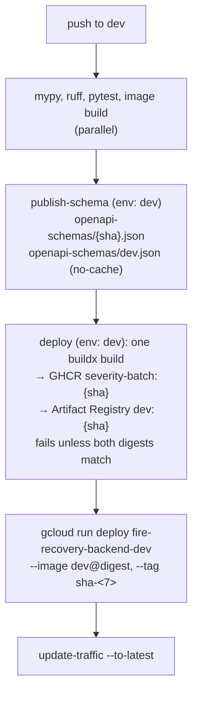

# dev-deployment — backend

## What this covers

How backend code reaches the **dev** Cloud Run service, the image the analysis Jobs run, and
the published OpenAPI schema. Also what proves dev runs a given commit, and how prod differs.

## What it does not cover

- Cluster provisioning: `deployment/k8s/README.md`.
- What a Job does: `smrt-design/severity-v2-2026-11.md`.
- The contract tests themselves.

## How it works

`.github/workflows/ci-cd.yml` runs on every push to `dev` or `main`, and on every pull request
whatever its base. Pull requests get the checks only. On a **push to `dev`**, one run does this:

- **The schema is published before the deploy.** A published `{sha}.json` proves CI passed at
  that commit, not that dev serves it. `dev.json` is uploaded with `Cache-Control: no-cache`;
  without it, GCS serves public objects with `max-age=3600`.
- **One image, two registries, one digest.**
  - Cloud Run runs the Artifact Registry copy.
  - The Jobs pull the public GHCR copy (`ghcr.io/schmidtdse/fire-recovery-backend/severity-batch`).
    The deploy passes it as `SEVERITY_IMAGE=…@digest`, so the API and its Jobs always run the
    same build.
- **The dev revision.**
  - It runs as `fire-severity-k8s-api-sa`, which reaches josh's GKE cluster with no key.
  - It has 1 vCPU and 512Mi, with CPU billed only during requests.
  - `--min-instances 1 --max-instances 1` keeps it on one instance, because the anonymous
    rate limit lives in memory.
- **Env vars and secrets merge into the service's.** `--update-env-vars` and
  `--update-secrets` add and replace, and never remove. A variable dropped from the workflow
  stays on the service until someone clears it with `gcloud run services update`.
- **A deploy can't reference an empty secret.** Every secret named in `--update-secrets`
  needs a version, readable by the runtime account, before the deploy runs. Otherwise Cloud
  Run refuses the revision.
- **Deploys queue per branch** (`concurrency: deploy-<branch>`, no cancelling). GitHub keeps
  one running and one pending deploy per group, and a newer pending one replaces an older one.
  So after rapid pushes, dev ends on the newest commit, and the commits in between may never
  deploy. `publish-schema` has no group.
- **Root paths ending in "z" don't reach the app.** Cloud Run's frontend answers some of them
  itself, which is why liveness is `/health`, not `/healthz`.
- **The Kind test (`.github/workflows/test-k8s.yaml`) is separate.** It runs on the same
  events, but it doesn't gate the deploy.

## Entry points

- `.github/workflows/ci-cd.yml` jobs:
  - `image` (`:132`): the PR build, pushing `severity-batch:{sha}` to GHCR for same-repo PRs
  - `publish-schema` (`:173`)
  - `deploy` (`:247`). The prod branch of its script is `:328-363`, the dev branch `:365-402`.
- `.github/workflows/test-k8s.yaml`: a Geology analysis as a Job on Kind, plus the bad-image
  failure path.
- `deployment/fastapi.Dockerfile`: the one image, for both the API and the Jobs.
- `deployment/prod-cloudbuild.yml`: prod only, see below.
- `deployment/k8s/`: the cluster side, applied by a person and never by CI.
- fire-recovery-iac `environments/fire-severity-k8s/`: the runtime account, its secrets, the
  bucket and its HMAC key. IaC owns the services' scaffolding, and this workflow owns their
  revisions.

## Cross-repo edges

- **fire-recovery-frontend** reads the API shape from the dev service's `/openapi.json` or the
  published `openapi-schemas/dev.json`, and renders COGs straight from
  `dse-nps-fire-severity-storage`.
- **josh's GKE cluster** runs the Jobs in namespace `fire-severity-dev`. The API's account
  holds a RoleBinding there.
- **fire-recovery-validation**'s sweep calls
  `https://fire-recovery-backend-dev-113009620257.us-central1.run.app`.

## What proves dev runs commit X

From strongest to weakest:

1. **`GET /version`** returns `git_sha` and `image`, from the revision's env, set by the
   deploy that built that image.
2. **`gcloud run services describe fire-recovery-backend-dev --region us-central1`** names
   the revision serving traffic, its image digest, its env and its secrets.
3. **A revision tag URL**, `https://sha-<7>---fire-recovery-backend-dev-113009620257.us-central1.run.app`,
   proves the revision was deployed. Old tags keep answering, so it doesn't prove that
   revision serves traffic.
4. **A published `{sha}.json`** proves CI passed at that commit, nothing more.

Each Job's result record (`v2/jobs/{job_id}.json`) carries the image digest and `git_sha`.

## Prod

- `main` runs the same workflow, but the prod branch of the deploy is still v1-shaped:
  - it builds with `prod-cloudbuild.yml` and deploys `prod:latest`, not by digest
  - it runs as `fire-recovery-backend-prod-sa`, at 8 vCPU / 32Gi with CPU always allocated
  - its secrets are v1's storage keys
- **Promoting today's `dev` to `main` would deploy v2's code with those settings.** With no
  `SEVERITY_TARGET`, the API falls back to the local launcher, so analyses would run as
  subprocesses inside the prod container. They'd use v1's storage keys against v2's default
  bucket. Nobody has tested that. Before promoting, the prod branch needs a v2 shape, and IaC
  needs a prod v2 environment (runtime account, secrets, RoleBinding).
- **Nothing gates a push to `main`.** The `dev` and `main` environments have no protection
  rules.
