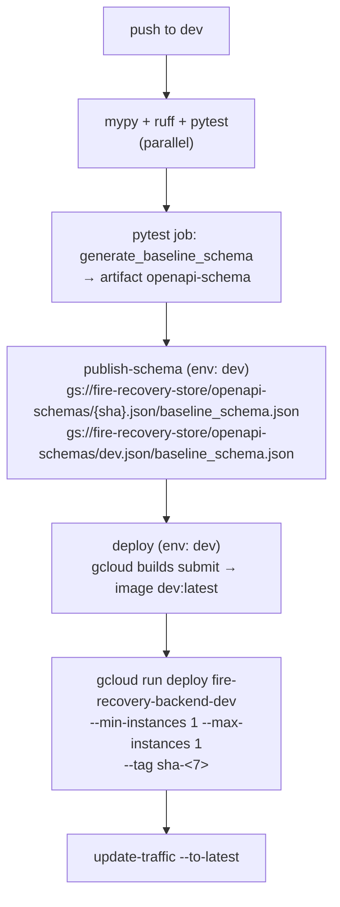

# dev-deployment — backend

## What this covers

How backend code reaches the **dev** Cloud Run service and the published OpenAPI schema
artifact. Both other repos gate work on `be-dev-deploy`, so "deployed to dev" has to mean a
specific, checkable thing.

## What it does not cover

Prod rollout policy beyond what's needed to answer question 5; the contract tests themselves.

## How it works

One workflow, `.github/workflows/ci-cd.yml`, runs on push and PR to `main` and `dev`. On a
**push to `dev`**, one run does all of this in order:

- **The schema is published before the service is deployed** (`deploy` has `needs:
  [publish-schema]`). A published schema only proves that CI passed at that sha. It does not
  prove the service is running that sha: the deploy job can still fail after publishing.
- **Published object names end in `/baseline_schema.json`.** `upload-cloud-storage` treats
  `destination:` as a folder, so `ci-cd.yml:201` and `:211` produce
  `openapi-schemas/<sha>.json/baseline_schema.json` and
  `openapi-schemas/dev.json/baseline_schema.json`. The run log for `3b30142` confirms this
  ("Uploading … to gs://fire-recovery-store/openapi-schemas/dev.json/baseline_schema.json").
  `https://storage.googleapis.com/fire-recovery-store/openapi-schemas/dev.json` returns
  `404 NoSuchKey`. The "Display schema URLs" step (`:217-221`) prints the wrong URLs.
- The image tag is always `dev:latest` (`deployment/dev-cloudbuild.yml`), not the sha. The
  workflow has no `concurrency:` group, so two close pushes can race: one run's
  `gcloud run deploy` can pick up the other run's `latest` image while tagging its own sha.

## Entry points

- `.github/workflows/ci-cd.yml`: `publish-schema` (`:159-221`), `deploy` (`:225-321`).
  Dev branch of the deploy script: `:292-316`. Prod branch: `:266-290`.
- `deployment/dev-cloudbuild.yml`, `deployment/prod-cloudbuild.yml`,
  `deployment/fastapi.Dockerfile`.
- `.github/workflows/legacy/*` is not run by GitHub (subdirectory). `build.yml` is
  `workflow_dispatch` only and builds the Coiled image, not the API.

## Cross-repo edges

- component:default/fire-recovery-frontend generates types and runtime constants from the
  published dev schema. The object that exists is
  `fire-recovery-store/openapi-schemas/dev.json/baseline_schema.json`, not
  `openapi-schemas/dev.json`.
- component:default/fire-recovery-validation's sweep calls the dev service,
  `https://fire-recovery-backend-dev-113009620257.us-central1.run.app`.

## Answers

1. **Branch.** `dev` deploys `fire-recovery-backend-dev` and publishes the dev schema. Both
   happen in the same workflow run, in order: publish, then deploy (see above). `main`
   targets `fire-recovery-backend-prod` and `openapi-schemas/main.json/…`. No `main.json`
   object exists yet (404), because `ci-cd.yml` has never run on `main`.
2. **Where to branch from.** `fix/gcs_multipart_411` @ `ab7fa19` is **already merged**
   into `dev` by PR #24 (merge `3b30142`). `git diff ab7fa19 origin/dev` is empty, so the
   trees are identical. Branch this plan's work from `origin/dev`. Note that the local `dev`
   ref in this mount is stale (at `4705890`), so fetch first. `main` is far behind: `dev` is
   262 commits ahead. `main` has 4 commits that `dev` lacks (`c569b1a`, `985ccc1`,
   `2013ea7`, `e8bd89f`, from May 2025 to Feb 2026, touching 23 files with formatting and
   MinIO details). `main` still carries the old `.github/workflows/deploy.yml`, not
   `ci-cd.yml`.
3. **`--max-instances 1` on dev.** Yes. The dev deploy sets `--min-instances 1
   --max-instances 1` at `ci-cd.yml:306-307`. The last dev deploy (run 33454873802, sha
   `3b30142`, 2026-09-01) succeeded with those flags. Live service config was not readable
   from here because `gcloud` has no credentials. Two caveats for the in-memory registry:
   - `gcloud run deploy --max-instances` is a per-revision setting. During a rollout the old
     revision's instance can still be running background tasks while the new revision
     serves. Every deploy also ends in-flight background work on the old instance. A
     resubmit after a deploy reaches an instance with an empty registry. That is fine if
     "unknown means re-run", but a deploy mid-sweep duplicates or loses in-flight jobs.
   - `ci-cd.yml:280`, the line the plan cites, is the **prod** branch of the script. It
     has never executed (see below).
4. **What signals "dev is running X".** From weakest to strongest:
   - `{sha}.json/baseline_schema.json` existing: CI passed at that sha. **Not** a deploy
     signal, because it is written before the deploy job runs.
   - Revision tag URL
     `https://sha-<7>---fire-recovery-backend-dev-113009620257.us-central1.run.app/` answering
     200: a revision with that tag was deployed (checked: `sha-3b30142` → 200, `sha-0000000`
     → 404). Old tags keep answering after newer deploys, so this does not prove the revision
     is serving traffic.
   - Live `GET /openapi.json` on the dev service matching the published schema. As of this
     check, the live schema, `dev.json/baseline_schema.json`, `3b30142….json/baseline_schema.json`,
     the committed `tests/contract/baseline_schema.json`, and `app.openapi()` at `ab7fa19` are
     all equal. This proves the served API shape, which is what the frontend gate needs.
     Two commits with identical schemas can't be told apart this way.
   - Nothing the service serves today names its commit. `GET /version` as planned carries
     only an `int` `PIPELINE_VERSION`, so it identifies the pipeline keyspace, not the commit.
     The only reliable check is the served schema: for `be-dev-deploy`, "live `/openapi.json`
     carries the `fire_event_name` pattern and `/version` answers".
5. **Prod.** A push to `main` triggers `ci-cd.yml` (once `main` contains it), and the
   `deploy` job deploys `fire-recovery-backend-prod`. **Nothing gates it.** The job
   references `environment: main`, but only a `dev` environment exists in the repo (`gh api
   …/environments`), and `dev` has no protection rules. `GCP_SA_KEY` is a repo-level secret, so
   the job authenticates. The "should require manual approval" comment at `ci-cd.yml:233` is
   not enforced. The last push to `main` (`e8bd89f`, 2026-02-23) ran the old `deploy.yml`,
   whose prod command has no `--max-instances` and a missing line continuation before
   `--allow-unauthenticated`. The run failed with exit 127. Prod's current instance limits
   are unknown from here. The frontend's prod cache check needs `dev` merged to `main`,
   which is a 262-commit promotion.

## Contradicts the plan

- **`openapi-schemas/dev.json` does not exist.** The plan's graph node "CI publishes
  `openapi-schemas/{sha,branch}.json` (already true)" and `be-dev-deploy`'s done-when ("The
  published `dev.json` carries …") name an object that CI does not write. The artifact is
  `openapi-schemas/dev.json/baseline_schema.json`. Either the consumers point at that name,
  or `ci-cd.yml` changes so the object is named `dev.json`.
- **"`--max-instances 1` deployed (already true)", citing `ci-cd.yml:280`.** That line is the
  prod branch, which has never run. For **dev** the claim holds via `:307`. For **prod** it is
  unestablished, and `be-cache-branch`'s in-memory registry has no guarantee there.
