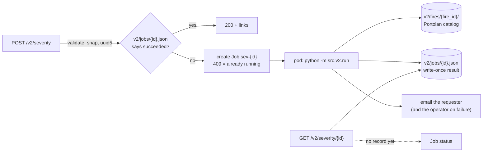

# Fire severity v2 — backend

## Summary

v2 replaces the analyze → refine → veg service with a single job. A user submits a fire
perimeter, two date windows and, optionally, an email address. They get a status URL at once,
and a link to the results when the job finishes. The job computes dNBR, RdNBR and RBR from
cloud-masked composites, with memory that stays flat however large the fire or long the
scene list. It publishes each analysis as a self-contained, Portolan-compliant catalog that
records exactly which scenes, windows and H3 cells it covers. The existing FastAPI service
keeps no job state. It validates the request, checks the cache, and starts one Kubernetes Job
per analysis, on josh's GKE cluster or on NRP Nautilus.

## Why

These numbers are measured on this repo (November 2026), not estimated.

**Memory grows with the fire and with the scene count.** The test fed synthetic input, shaped
like stackstac's output, through the repo's own compute and COG code on 4 threads:

| Output grid | Scenes per window | Today | Bounded prototype |
|---|---|---|---|
| 1 Mpx | 6 | 0.70 GiB | 0.44 GiB |
| 38 Mpx (≈ 100 km box) | 6 | 3.70 GiB + 0.31 GiB tmpfs | 0.54 GiB |
| 4 Mpx | 48 | 3.13 GiB | 0.39 GiB |

The prototype runs the same math, matches outputs to float32 precision, and is 2.5–4× faster.

**Causes:**

- **The output grid comes from scene footprints.** stackstac chooses it. Both providers now
  publish `proj:code`, which stackstac 0.5.1 ignores, so the narrowest partial-swath scene
  sets the pixel width: Eureka came out at 13.4 m × 19.9 m.
- **Each index is computed separately.** Source pixels are read three times, and all results
  are held in float64.
- **The stack spans prefire start to postfire end.** Scenes between the two windows are read
  too.
- **COG temp files go to `/tmp`,** which on Cloud Run is RAM.

**The published catalog can't be fixed in place.**

- Three code paths disagree on where files live. As a result, `self` links and the root's
  collection links return 404, and no collection links to its items.
- The COGs mark NaN pixels as valid, carry no statistics, and get no overviews when their
  short side is ≤ 512 px.
- Result polling treats "the STAC item exists" as "the job is done", which makes the catalog
  layout part of the API contract.

**A spike passes Portolan.** It ran Eureka on real Sentinel-2 data and built the catalog with
portolan-cli 0.9 plus a ~50-line enrich plugin. rashid reported 0 errors, byte-level checks
included. The one warning came from publishing the perimeter. Without the perimeter (§4), the
same catalog has 0 errors and 0 warnings.

## Scope

**In scope:**

- one submit and status API, with optional email
- the bounded pipeline, with cloud masking
- per-analysis catalogs with provenance
- running each analysis as a Kubernetes Job, on either of two clusters
- replacing MinIO with RustFS in CI and local development
- `/healthz` and `/version`

**Out of scope for v2:**

- refine, the veg matrix, and the GeoJSON/shapefile upload endpoints (3.6k source lines)
- the command executor and registry (1.1k)
- the v1 STAC managers (1.3k)
- the refine/veg/upload tests (5.9k lines)
- frontend changes

**Kept:**

- the provider chain (`stac_endpoint_handler.py`, `config/stac_providers.json`)
- `geo_ops.buffered_bounds`
- `date_windows`
- the provenance model, adapted

## Design

### 1. Execution: a stateless API and one Kubernetes Job per analysis



- **State.** We keep no job state of our own. Three things exist, each with one writer:
  - the published catalog
  - a write-once result record, `v2/jobs/{id}.json`, which the job writes as it ends: either
    "succeeded" with links, or "failed" with a short error
  - while the analysis runs, the Kubernetes Job itself, named `sev-{job_id}`
- **Submit.** The API derives the job id (§6). A succeeded record is a cache hit, and the API
  returns the links. Otherwise it creates the Job. Kubernetes rejects a second Job with the
  same name, so two identical submissions can't start two runs, and no lock is needed.
- **Status** comes from the result record if one exists. Otherwise it comes from the Job:
  pending, running, or failed with the reason Kubernetes gives. Neither depends on the catalog
  layout.
- **Retries can't run away.** The Job spec retries only what the platform did to us: an evicted
  or preempted pod is rescheduled. Our own failures are never retried, and a hard deadline caps
  the whole run, rescheduling included. A failed analysis runs again only when someone
  resubmits it. The API then deletes the finished Job and creates a new one under the same
  name.
- **Failures are reported.** On any exception, the job:
  1. writes a failed record
  2. emails the requester a short notice
  3. emails the operator the traceback, the request and the job id
  4. exits non-zero

  Platform failures, such as an OOM kill, the deadline, or a bad image, never reach that
  handler. The status URL reports them from the Job, and on josh's cluster a log-based alert
  emails the operator. For now that's enough, and the requester gets no email in that case.
- **Two targets.**
  - The launcher's Kubernetes implementation takes a target profile, as josh's does. The
    profile holds the credentials, the namespace, scheduling fields (node selectors,
    tolerations), and resource requests and limits.
  - NRP, for example, requires limits within 20% of requests and penalizes requests that go
    unused. Bounded memory makes both easy to meet.
  - The API's configuration names one target, josh's GKE cluster by default. Switching to NRP
    Nautilus is a configuration change.
  - Job names are unique per cluster, so switch targets only when no Jobs are running.
- **API deploys don't touch running jobs.** The API also no longer needs memory headroom for
  GDAL.
- **No version skew.** CI publishes the image to GHCR, as josh does, so both clusters can pull
  it, and gives the API its digest. The API starts Jobs with that digest. The code that
  computed a job id is therefore the code that runs it.
- **Local runs.** The launcher has two methods, `start(job_id, request)` and `state(job_id)`,
  with a subprocess implementation for local work and tests and a Kubernetes one for deploys.
  `src.v2.run` is a plain CLI either way.

```yaml
apiVersion: batch/v1
kind: Job
metadata:
  name: sev-{job_id}                 # deterministic, so a duplicate create returns 409
  labels: {app: severity-v2}
spec:
  backoffLimit: 0                    # a failure of ours is never retried...
  podFailurePolicy:
    rules:
      - action: Ignore               # ...but an evicted or preempted pod is rescheduled
        onPodConditions: [{type: DisruptionTarget}]
  activeDeadlineSeconds: 21600       # 6 h for the whole run, rescheduling included
  ttlSecondsAfterFinished: 86400     # the Job object goes after a day; the record stays
  template:
    spec:
      restartPolicy: Never           # required by podFailurePolicy
      # node selectors, tolerations and limits come from the target profile
      containers:
        - name: run
          image: ghcr.io/schmidtdse/fire-recovery-backend@sha256:<the API's own digest>
          args: [python, -m, src.v2.run]
          env:
            - {name: SEVERITY_REQUEST, value: "<canonical request JSON>"}
            - {name: JOB_ID, value: "<job id>"}          # the job re-derives it and checks
            - {name: STATUS_URL, value: "<status URL>"}  # for the email
            - {name: NOTIFY_EMAIL, value: "<requester, optional>"}
            - {name: SEVERITY_WORKDIR, value: /scratch}
          envFrom:
            - secretRef: {name: severity-v2}   # storage and SMTP credentials
          resources:
            requests: {cpu: "2", memory: 2Gi, ephemeral-storage: 10Gi}
          volumeMounts: [{name: scratch, mountPath: /scratch}]
      volumes: [{name: scratch, emptyDir: {sizeLimit: 10Gi}}]
```

`src/v2/k8s.py` (`job_manifest`) builds this from the target profile in `config/targets/`.

**Why Kubernetes.**

| | Kubernetes Job (chosen) | Cloud Run Job | In the API service (first draft) |
|---|---|---|---|
| Time limit | none; we set 6 h | 168 h per task | none, but any deploy or restart kills the job |
| Dedupe and in-flight status | from the Job name | executions can't be named, so a marker object | an in-process queue and `status.json` |
| Retries | by cause (`podFailurePolicy`, GA since 1.31) | a count, whatever the cause | requeue-on-startup code |
| Scratch space | disk | RAM | RAM |
| Where it runs | any cluster: josh's GKE, NRP Nautilus | GCP only | GCP only |
| New infra | a namespace per cluster | none | none |

Cloud Run's one-hour limit applies to service requests. The first draft avoided it by doing the
work outside the request, and that is what forced the requeue state. Runtime doesn't decide the
choice anyway: a 4 Mpx box reads and composites in 14 s (§2). What decides it is state and
portability. josh already dispatches Jobs to GKE and to Nautilus and polls the Job API for
status, so the pattern is already in use here.

**Portability.** Nothing in the dispatch path is specific to GKE:

- The Job uses standard `batch/v1` fields. `podFailurePolicy` needs Kubernetes 1.26 or later.
- The image is public and credentials come from a namespace Secret.
- Status comes from the Job API, so the status URL works on any cluster.
- One piece is GCP-flavored: the log-based alert. On NRP, use its own monitoring.
- If the GCS check in §7 passes, storage is S3 with HMAC keys on every cluster. If it fails,
  GCS needs `gs://` credentials on each cluster instead.
- Email is best-effort (§8), so a cluster that blocks outbound SMTP still runs jobs.
- NRP's published policies set no runtime cap on Jobs; only bare pods are removed after 6 h.

### 2. Pipeline

1. **Search.** Search each window separately. Both windows must come from the same provider,
   using the existing chain and coverage rule. Record each scene's id, datetime and href.
   Searches are unsigned. Planetary Computer hrefs are signed as each block is read (odc-stac's
   `patch_url`), so a slow job never reads with an expired token.
2. **Grid.**
   - **Snap.** Snap `buffered_bounds` outward to the tiles of OGC's WebMercatorQuad tile matrix
     set, the z/x/y grid web maps use, as implemented by morecantile (which TiTiler uses). Pick
     the zoom whose tiles are about an eighth of the box's longer side. The eighth is a
     placeholder, and §6 shows the trade-off behind it.
   - **Raster extent.** Project the snapped box to the UTM zone of its centroid, then snap it
     outward to the sensor's native pixel grid. Sentinel-2 L2A origins are multiples of 20 m,
     and Landsat C2 L2 origins sit 15 m off multiples of 30 m (both checked on Element 84
     items). Output pixels then coincide with source pixels, so nearest-neighbour reads are
     exact.
   - **H3 cells, for GLEN.** Record the H3 cells that overlap the extent, at the finest level
     where about 25 cells' average area covers it. Small fires get small cells and big fires
     big ones. The cells are metadata (§5) and don't affect the key.
   - **Resolution** is 20 m for Sentinel-2 (B8A, B12, SCL) and 30 m for Landsat.
3. **Load** with odc-stac, not stackstac:
   - It reads `proj:code` (projection v2) without the shim.
   - It groups scenes by solar day, so the tiles of one overpass become one time step (14 items
     became 11 days in the 40 km test below).
   - It reads native uint16, 4× smaller than stackstac's float64. Each band's type and nodata
     are passed to it (`stac_cfg`), because Planetary Computer's Sentinel-2 items publish no
     `raster:bands` and would otherwise load as float32.
   - It doesn't apply `raster:bands` scale and offset, so we do, after asserting they are
     identical across the window. Sentinel-2 windows that straddle the January 2022
     processing-baseline change fail that check, and are rejected for now.
   - Planetary Computer's Sentinel-2 items carry no scale or offset at all (checked November
     2026). For them, the scaling comes from the product's rule: 1e-4, with −0.1 from
     processing baseline 04.00 (`s2:processing_baseline`). v1 read these items unscaled, so
     its post-2022 NBR from that provider carried the +1000 DN offset.
   - stackstac has had no release since August 2024. Its projection-v2 PR has been open since
     December 2024, and its tracker has an open "Has the project been abandoned?" issue.
4. **Mask** before compositing, using each product's own flags:
   - **Sentinel-2 SCL:** no data, saturated or defective, cloud shadow, medium- and
     high-probability cloud, thin cirrus, and snow (classes 0, 1, 3, 8, 9, 10, 11).
   - **Landsat QA_PIXEL:** fill, dilated cloud, cirrus, cloud, cloud shadow, and snow (bits
     0–5).
   - **Smoke:** no standard smoke flag exists. SWIR sees through most smoke, thick plumes are
     usually flagged as cloud, and the median absorbs the rest.
   - A pixel with no clear observation in a window becomes nodata.
5. **Plan.** Pick a block side so that one band of one window over the block, every day
   included, stays at or below 32 MiB at uint16. Only the scenes that touch a block are read
   for it. Memory stays flat: 4.6 Mpx with 45-day windows peaked at 0.51 GiB on 2 threads
   (64 MiB blocks peaked at 0.84 GiB). Runtime scales with pixels × days.
6. **Compute** one spatial block at a time, reading one date window and then the other:
   1. Take each window's median NIR and SWIR, in strips of rows so the median's sort stays
      small.
   2. Compute prefire and postfire NBR once.
   3. Apply each registered index.
   4. Write float32, with NaN replaced by the nodata value −9999, to one tiled GeoTIFF per
      index on the pod's disk.
7. **COGs.** Build them with GDAL's COG driver:
   - DEFLATE compression with the predictor
   - 512 px tiles
   - overview count sized from the longer side
   - `STATISTICS=YES`, which embeds min, max, mean, stddev and valid percent
8. **Catalog.** Run `portolan init`, `add`, `check --fix` and `readme`, with our plugin
   enriching the STAC (§5). Any rashid error fails the job.
9. **Publish** with `portolan push` (§7) into the analysis's own prefix, emptying it first. That
   prefix belongs to this job id, and a cluster runs at most one Job per id. Then write the
   result record and send the email.

These loads used real data from Element 84 around Eureka, run from a laptop devcontainer on 8
threads. They used whole-array compute, not the bounded loop:

| Box | Pixels | Items → days | Read + composite | Masking |
|---|---|---|---|---|
| 8 km | 0.16 Mpx | 11 days | 2.0 s | removed ~⅓ of observations; RBR p99 0.161 → 0.193 |
| 40 km | 4 Mpx | 14 → 11 | 13.7 s | removed ~⅓ of observations; RBR p99 0.132 → 0.084 |

The masked observations were real cloud: in the 8 km box, SCL showed three of the eleven days
as mostly or entirely cloud. Masking barely moved the mean RBR, but it raised the tail in the
box that is mostly burn scar and lowered it in the box that is mostly unburned. That fits cloud
diluting the burn signal in one place and faking it in another. At this rate, a 38 Mpx fire
reads in about two minutes.

### 3. Indices and how to extend them

v1's calculators are classes that call each other, which is why NBR gets recomputed. v2 uses a
registry of pure functions over composites that are computed once per window:

```python
@dataclass(frozen=True)
class Index:
    name: str                                 # asset key and band name, e.g. "rbr"
    title: str
    description: str                          # formula and citation, copied into STAC
    needs: tuple[str, ...]                    # composites it reads, e.g. ("nir", "swir")
    fn: Callable[[Composites], np.ndarray]    # pixel-local, returns float32

INDICES = (DNBR, RDNBR, RBR)
```

- **An index on the same inputs** (e.g. an NBR variant) is one new entry. It gets its own COG,
  asset, band statistics and README line automatically.
- **An index that needs new bands** (e.g. red, for an NDVI-based index): add the band for each
  sensor in `stac_providers.json`. The load reads the union of every entry's `needs`.
- **Anything not pixel-local** (neighbourhood operations, a different compositing method,
  models) falls outside this model. It would need overlapping blocks or its own stage, and is
  deferred.
- **Version bumps.** Any change to a formula, the compositing or the mask bumps
  `PIPELINE_VERSION`. The version is recorded in every item and is part of the job id.

Each index is one single-band COG whose asset key is the index name. portolan-cli keys an
item's primary file as `data`. The plugin renames it, and the spike showed the rename is
idempotent.

### 4. Catalog layout: one catalog per analysis

```text
v2/fires/{fire_id}/                  self-contained Portolan catalog
  catalog.json  README.md  AGENTS.md
  {fire_id}/                         the analysis's collection
    collection.json  README.md  AGENTS.md  items.parquet
    severity/                        the analysis item
      severity.json
      dnbr.tif  rdnbr.tif  rbr.tif   (+ thumbnails)
v2/jobs/{job_id}.json                write-once result record
```

- **`fire_id`** is `{slug(fire_event_name)}-{job_id[:8]}`: deterministic, and unique per cache
  key.
- **Why one catalog per analysis:**
  - No job ever updates a shared file, so there's no locking and no lost update.
  - Reruns are idempotent.
  - GLEN can import each analysis on its own.
- **The submitted perimeter isn't published.**
  - The product is a function of the cache key (§6). The key holds the snapped extent, not the
    perimeter, so two submissions that share a key share a catalog.
  - The item's geometry is the raster's footprint, and `fire:h3` lists the cells (§5). The
    requester already has their perimeter, and it isn't stored.
  - This also clears rashid's only warning, PTL-DAT-005. The perimeter was a collection-level
    asset, and its footprint differed from the collection's extent (the buffered raster) by
    more than rashid's 0.01° tolerance.
- **A view across fires.**
  - Portolan's way to query items without fetching every JSON is `items.parquet`, the
    collection's "item mirror". It is a SHOULD for every collection with items. portolan-cli
    writes it by default, and rashid checks that it matches the item JSON.
  - The spec defines no catalog-level or cross-collection mirror. A DuckDB glob over
    `v2/fires/*/*/items.parquet` is therefore the cross-fire table, which needs list access on
    the bucket. Its `fire:h3` column lets GLEN join analyses to other H3-indexed layers by
    cell. Levels differ between analyses, and h3's parent and child functions relate them.
  - For clients that can't list, a scheduled job can concatenate the mirrors into
    `v2/index/fires.parquet`. That file is derived and disposable, and never the source of
    truth.
- **The `v2/` prefix** keeps clear of v1's `stac/` and `assets/`.

### 5. Metadata

The pipeline writes a sidecar file. The plugin, through `portolan_enrich_item` and
`portolan_enrich_collection`, copies it into the STAC every time `add` runs. The job passes the
sidecar's path in `FIRE_SEVERITY_SIDECAR`. The file sits outside the catalog directory, so push
never uploads it.

| Field | Content |
|---|---|
| `start_datetime`, `end_datetime` | prefire start and postfire end; also the collection's temporal extent |
| `fire:prefire_window`, `fire:postfire_window` | the requested windows |
| `fire:prefire_scenes`, `fire:postfire_scenes` | `[{id, datetime, href}]` for every scene used |
| `fire:source` | provider, STAC API, collection, band names |
| `fire:h3` | `{res, cells}`: the H3 cells that overlap the raster, at a level scaled to its size (typically 15–25 cells); metadata, not part of the key |
| `fire:grid` | `{epsg, resolution, bounds}` of the output raster, plus the WebMercatorQuad tile range it came from (the spatial part of the key) |
| `fire:mask` | the mask band and the classes or bits removed |
| `fire:sensor`, `fire:composite` | e.g. `sentinel-2`, `median` |
| `fire:event_name`, `fire:job_id`, `fire:pipeline_version` | identity |
| portolan-generated | `proj:*`, `file:size`, `file:checksum`, per-band `nodata` and `statistics`, thumbnails, `items.parquet` |

- **Lineage lives in properties.** Portolan restores `links` after plugins run, so scene
  lineage goes in properties (with hrefs) rather than in `derived_from` links.
- **Providers and license.** DSE is the only provider (producer, processor and host), and the
  license is CC-BY-4.0. These, the contact details and the README's provenance text all come
  from `.portolan/metadata.yaml`.
- **Thumbnail.**
  - portolan 0.9 renders a grayscale thumbnail per COG with its own stretch, and points the item
    at the first one, dnbr.
  - The plugin points it instead at RBR, rendered with a fixed 0–0.5 ramp as the explorer uses.
  - Checked: portolan keeps a thumbnail drawn before `add`, and stamps its size and checksum.
    It also tracks the file as a second thumbnail asset, which the plugin removes. rashid
    passes the result with 0 errors and 0 warnings.

### 6. Job identity, cache and API

- **Key.** The job id is the uuid5 of:

  ```python
  canonical = {
      "operation": "fire_severity_v2",
      "pipeline_version": PIPELINE_VERSION,
      "fire_event_name": name,              # D8/D20: validated, never transformed
      "sensor": sensor,                     # DEFAULT_SENSOR applied first
      "prefire_window": [start, end],       # verbatim strings
      "postfire_window": [start, end],
      "tiles": {"tms": "WebMercatorQuad", "z": z, "x": [x0, x1], "y": [y0, y1]},  # §2, step 2
  }
  ```

- **What shares a key.** The geometry enters only through the snapped box, so perimeters whose
  buffered boxes snap to the same tile range share a key. Anything else that differs (name,
  windows, sensor, version) makes a new analysis. The Job receives the canonical form and
  nothing else, so everything it publishes is a function of the key. That is why the buffer
  distance, which depends on the perimeter, isn't recorded.
- **Names** match `^[A-Za-z0-9_-]+$` and are at most 128 characters (D20), which keeps
  `v2/fires/{fire_id}/{fire_id}/…` far below GCS's 1024-byte object-name limit.
- **The trade-off.** A coarser snap keeps more keys stable but adds more area. The product has
  to cover every box that maps to its key, so the extra area is the price of a stable key. The
  table shows random placements of the Eureka perimeter and of copies scaled to 30 km and
  130 km boxes, each shifted by up to 50 m:

  | Snap | Extra area, mean (7 / 30 / 130 km) | Keys kept (7 / 30 / 130 km) |
  |---|---|---|
  | WebMercatorQuad tiles ≈ ⅛ of the box | +30% / +33% / +26% | 96% / 97% / 100% |
  | WorldCRS84Quad tiles ≈ ⅛ of the box | +34% / +18% / +29% | 98% / 97% / 100% |
  | S2, cells ≈ ⅛ of the box | +58% / +66% / +51% | 73% / 93% / 96% |
  | H3, ~25 cells per box | +141% / +134% / +192% | 87% / 95% / 99% |

  - **Square tiles aligned with the box win.** A lat/lon box sits square on both OGC tile
    grids, so snapping adds about half a tile per side. S2's quads are skewed against lat/lon
    lines, and H3's hexagons can't line up at all, so their outer ring pokes further out.
  - **Why WebMercatorQuad.** It's the least contentious choice: the z/x/y grid behind nearly
    every web map, defined in OGC's Two Dimensional Tile Matrix Set standard (17-083r4) and
    implemented by morecantile. WorldCRS84Quad, its lat/lon twin in the same standard, costs
    the same and would do as well. Either gives a global key, with no UTM zone to flip near a
    zone boundary.
  - **Nothing ad hoc is added.** The margin around the perimeter is v1's `buffered_bounds`, and
    the snap is just the standard's tile boundaries.
  - **Tile size is the dial,** and each zoom level halves it. On a plain UTM square grid, which
    has the same geometry, tiles of about a quarter of the box kept 95–100% of keys for
    +50–70% area. About a sixteenth cost +12–16% and kept 78–97%.
  - **H3 can't be tuned that finely.** Its levels step 7× in area. One level finer cut the 7 km
    box's extra area to +62%, but also cut its kept keys to 57%.
  - **DGGS terms.** OGC defines these as tile matrix sets rather than DGGSs. Like H3 and S2,
    they aren't equal-area: tiles shrink toward the poles, and WebMercatorQuad stops at ±85°.
    Neither matters for an internal cache key, and the raster itself is in UTM. H3, in the
    metadata, is the DGGS that GLEN joins on.
- **Naming the same fire twice** computes it twice. That's cheaper than serving one requester
  another's results.
- **Normalization and vectors** come from `deterministic-job-id-2026-09` (see Relationship to
  other plans). The vectors include a small shift that keeps the snapped extent (same id) and
  one that changes it (new id). No v2 ids exist yet, so there is nothing to migrate.
- **Cache.** Only success is a hit (D6). A failed record means the next submission reruns.
- **`POST /v2/severity`** takes `{fire_event_name, geometry, prefire_window, postfire_window,
  sensor?, email?}`:
  - On a hit, it returns `200 {job_id, state: "succeeded", grid, catalog_url, assets}`. The
    response carries the links, so the API never sends mail.
  - Otherwise it returns `202 {job_id, grid, status_url}`. The status URL always works, so
    email stays optional.
  - A request that joins a job already running gets the status URL only. The email goes to the
    requester whose submission created the Job.
- **`GET /v2/severity/{job_id}`** returns the state, any error, the catalog and asset URLs, and
  scene counts.
- **Limits** are placeholders until there's usage to size them:
  - The buffered box is at most 100 Mpx at the sensor's resolution, about 200 km × 200 km for
    Sentinel-2. Snapping adds up to about half again.
  - Each window is at most 90 days.
  - At most 4 Jobs run at once, counted from the Job API by label. Beyond that the API returns
    `429` with `Retry-After`. Retrying is safe because the id is deterministic.
- **Access.**
  - Anonymous submissions are rate-limited per IP, in memory. There is one instance, so the
    count is exact, and resetting on deploy is fine.
  - An API key lifts that limit for programmatic clients. Keys are a hashed list from Secret
    Manager, as with josh's `JOSH_API_KEYS`.
  - Cache hits cost nothing and aren't limited.
- **`/healthz` and `/version`** sit at the root and do no I/O. `/healthz` is liveness.
  `/version` returns the pipeline version, the commit, and the image Jobs run.
- Once built, the generated OpenAPI schema is the contract, not this section.

### 7. Publishing and storage

- **How push writes.** `portolan push` writes through obstore:
  - `s3://` with `AWS_ENDPOINT_URL` for any S3-compatible store (RustFS, MinIO, AWS)
  - `gs://` for GCS

  It uploads assets, then items, then `collection.json`, then `catalog.json`. A reader
  therefore never sees a catalog whose files are missing.
- **One protocol everywhere: S3 with HMAC keys.**
  - Production stays on GCS, through its S3 endpoint, as v1 uses it today.
  - CI and local development move from MinIO to RustFS. CI still runs the frozen
    `bitnamilegacy/minio` image, and local development follows `docs/DEVELOPING.md`.
- **GCS's S3 endpoint probably accepts push now.**
  - push uses multipart uploads for any file over 5 MiB. Eureka's COGs came to about 3.5 bytes
    per pixel, so a COG crosses that threshold at roughly 1.5 Mpx.
  - PR #24's `411 Length Required` came from obstore 0.8.2, which starts a multipart upload
    without a `Content-Length` header. obstore 0.11.1 (v1's current lock) and 0.12.1
    (portolan's) both send `Content-Length: 0`, checked against a local stub.
  - push also makes conditional writes (`If-None-Match`, `If-Match`) on `versions.json`.
    Those haven't been tested against GCS either.
  - One push of a catalog with a COG over 5 MiB to the GCS bucket's S3 endpoint settles both.
    If it fails, push to GCS with `gs://` instead (see Deferred).
- **CI checks RustFS the same way:** its push test uses a COG over 5 MiB.
- **What GLEN needs** from whatever serves `v2/fires/`: public read, CORS and range requests.

### 8. Notification

- **Sender.** A new Gmail account, sending over SMTP with an app password (which needs 2-step
  verification), through the standard library.
  - That is the whole setup: one account, one app password, and the credentials in each
    cluster's `severity-v2` Secret.
  - Moving to a relay later is a configuration change.
  - GCP blocks outbound port 25 only, so ports 465 and 587 work from GKE. Check NRP's egress
    rules when it's set up.
- **Not the Gmail API.**
  - With a service account, it needs Workspace domain-wide delegation.
  - With a personal account, it needs an OAuth refresh token, and that token expires after 7
    days while the app is in testing.
- **Only jobs send mail.** On success, the link. On failure, a short notice to the requester
  and the traceback to the operator. A cache hit needs no email, because the API's response
  already carries the links. The API therefore holds no mail credentials.
- **Best-effort.** A failed send is logged and never fails the job. The result is on the status
  URL either way.
- **Addresses.** The operator address is configuration. The requester's address reaches the pod
  as an environment variable and disappears with the Job object after a day. It is never
  written to the bucket.
- **Abuse.** The form sends mail to any address. The message is fixed text with a link, and the
  §6 rate limits apply.

### 9. Dependencies

- **One environment.** v1's `rio-cogeo <6` pin is what forced the separate `portolan` pixi env.
  v2 doesn't use rio-cogeo directly, so a single env can hold portolan-cli, rashid and rasterio
  ≥ 1.4.4. The geo stack, pyarrow included, comes from conda-forge.
- **odc-stac** replaces stackstac in v2.
- **portolan-cli 0.9.0 and rashid 0.3.0 are pinned exactly.** Bump them deliberately, and rerun
  the acceptance fixtures when you do. AGENTS.md stays portolan's generated template for now.
- **h3 is pinned exactly.** The covering uses h3-py's
  `h3shape_to_cells_experimental(..., contain="overlap")`, which has no API stability
  guarantee. An upgrade can change only the recorded cells, never the key.
- **morecantile is pinned.** It computes the tile snap, implements OGC's tile matrix sets, and
  is what TiTiler uses.
- **The `kubernetes` client** backs the launcher.
- **CI publishes the image to GHCR.**
- **Packaging the plugin.** portolan loads plugins only through the `portolan` entry-point group.
  The repo therefore needs a minimal `pyproject.toml`, installed as an editable pixi path
  dependency.

## Rollout

1. **Build.** Branch off `dev`, delete the v1 routes and commands on that branch, and build v2.
   Validate it locally:
   - with the subprocess launcher
   - against RustFS, which replaces MinIO in CI and in `docs/DEVELOPING.md`
   - against the real providers
2. **Provision**, before the merge. IAM details are deferred (see below).
   - a `fire-severity-dev` namespace on josh's GKE cluster, and one on NRP Nautilus
   - in each namespace, the `severity-v2` Secret (storage and SMTP credentials)
   - the image on GHCR
   - the API's credentials for each target
   - a log-based alert on failed Jobs on josh's cluster
3. **Deploy.** Once the acceptance checks pass:
   1. Merge `dev` into `main`, so prod keeps v1.
   2. Merge the v2 branch into `dev`. The dev Cloud Run service then serves v2 through the
      unchanged CI/CD, with no new staging environment.
4. **Before that merge:**
   - Push a catalog with a COG over 5 MiB to the GCS bucket's S3 endpoint (§7).
   - Land or park anything in flight on `dev` for v1.
   - Regenerate `tests/contract/baseline_schema.json`. The stability test will flag the break,
     which is expected.
   - Accept that anything pointed at the dev backend, such as the dev frontend, stops working.

**Retiring v1:**

- **At the switch,** v1 stops writing. `stac/` and `assets/` stay as they are, read-only.
- **Fires still needed are rerun through v2,** not converted. A rerun takes minutes. Converting
  would mean fixing the catalog problems listed under Why.
- **Prod moves to v2** by the same dev → main promotion, once v2 has run on dev.
- **The v1 trees go last.** Once nothing reads `stac/` and `assets/` (the frontend, the
  explorer, validation), archive or delete them.

## Acceptance

- Every published analysis passes `rashid check` with 0 errors and 0 warnings.
- A ~38 Mpx, 48-day job peaks under 1 GiB of pod memory, recorded in its result record.
- End-to-end fixtures pass for:
  - Eureka (small)
  - a fire about 100 km across
  - an AOI that straddles two UTM zones
  - a Landsat run
  - a long gap between windows
- The Eureka fixture runs on both targets, with matching pixel values.
- An identical resubmission returns the same job id and starts no Job. So does a perimeter
  shifted slightly without changing its snapped extent.
- A Python error writes one failed record, retries nothing, and emails both the requester and
  the operator.
- A pod evicted with `kubectl drain` is rescheduled, and the job completes.
- A deadline overrun fails the Job and shows on the status URL.
- CI pushes a COG over 5 MiB to RustFS, and the same push to GCS's S3 endpoint succeeds.
- The index unit tests reproduce today's calculator values.

## Decisions

Recorded 2026-11-09.

| # | Question | Decision |
|---|---|---|
| 1 | Notification | The status URL always works. Email is optional, sent over SMTP (§8). |
| 2 | Cloud and smoke masking | Each product's own flags (SCL, QA_PIXEL). No smoke mask (§2). |
| 3 | A view across fires | Each analysis publishes an `items.parquet` mirror, plus a derived index if one file is needed (§4). |
| 4 | Reruns | The same key gives the same catalog. Anything else gives a new one, and nothing is merged (§6). |
| 5 | Limits | Generous, bounded by one pod, with a concurrency cap, per-IP limits and API keys (§6). |
| 6 | stackstac or odc-stac | odc-stac. Portolan governs what we publish, not how we read (§2). |
| 7 | Planetary Computer signing | Re-sign per window (§2). |
| 8 | Publish target | S3 with HMAC keys everywhere: GCS's S3 endpoint in production, RustFS in CI and local development (§7). |
| 9 | Providers and license | DSE only, under CC-BY-4.0 (§5). |
| 10 | portolan-cli | Pinned, with its generated AGENTS.md (§9). |
| 11 | Thumbnail | RBR with a fixed 0–0.5 ramp (§5). |
| 12 | PTL-DAT-005 | Gone, because the perimeter isn't published (§4). |
| 13 | v1's `stac/` tree | Read-only from the switch, retired once unused (Rollout). |
| 14 | Requeue | No requeue code. The Job spec retries platform disruptions under a deadline, and our own failures are reported, not retried (§1). |
| 15 | Cache | Keyed on the snapped buffered bounds (§6). |
| 16 | Where jobs run | Kubernetes Jobs on josh's GKE cluster, with NRP Nautilus as a second target. IAM comes later (§1). |
| 17 | Snapping | OGC WebMercatorQuad tiles about an eighth of the box, via morecantile. H3 cells are recorded for GLEN but don't set the key (§2, §6). |
| 18 | Email sender | A new Gmail account over SMTP. Only jobs send mail (§8). |
| 19 | Numbers | Placeholders for now (§6). |
| 20 | Mixed processing baselines | Rejected for now (§2). |
| 21 | RustFS | Part of v2: it replaces MinIO in CI and local development (§7). |
| 22 | Email on platform failures | Not for now. The status URL and the operator alert are enough (§1). |
| 23 | Other clusters | Supported through the target profile, with nothing GKE-specific in the dispatch path. Each cluster is monitored with its own tools (§1). |

## Open questions

1. **H3 levels for GLEN.** Levels vary with fire size. Confirm the GLEN team can relate them
   through h3's parent and child functions. The JOTR explorer's CWHR layer, for one, is
   indexed at res 10.

## Deferred: IAM and credentials

To set up per target when the service account gets its permissions:

- **The API's credential** to create, get, list and delete Jobs, and to read pod logs, in the
  target's namespace.
- **Storage credentials for the job.** HMAC keys in each namespace's Secret, which work on any
  cluster. If the GCS check in §7 fails, `gs://` needs workload identity on GKE and a
  service-account key on NRP.
- **The SMTP credentials.**
- **Outbound SMTP on NRP.** Unconfirmed. Email is best-effort until it is (§8).
- **The image** needs none, because it is public on GHCR.

## Relationship to other plans

`deterministic-job-id-2026-09`:

- **v2 reuses** its normalizer, its name rule (D8, D20), D6, and its committed-vectors
  approach.
- **v2 departs** from its canonical form. The WebMercatorQuad tile range replaces the
  geometry, so perimeter jitter that leaves the tile range unchanged doesn't change the id.
- **These parts don't apply under v2:**
  - the refine and veg parts of `be-name-validation` and `be-job-id-format`
  - `be-result-path`'s v1 result files
  - `be-cache-branch`'s in-memory registry, which the result record and the Job name replace
